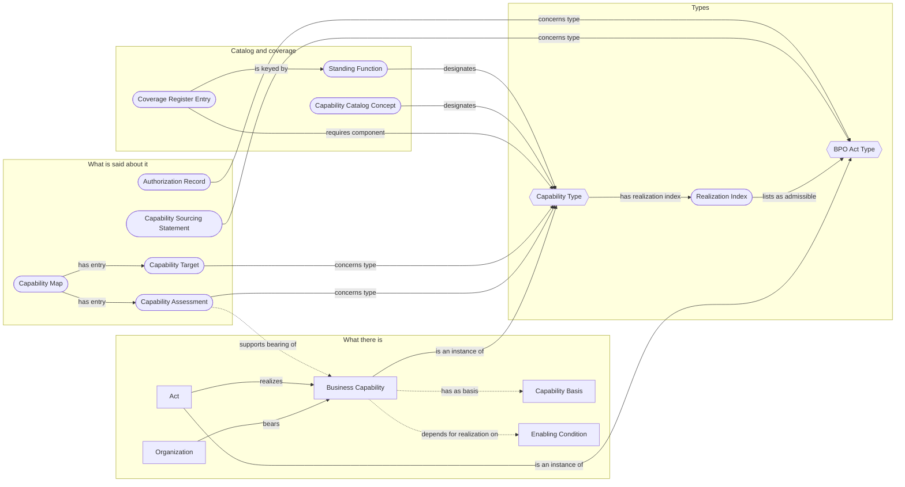
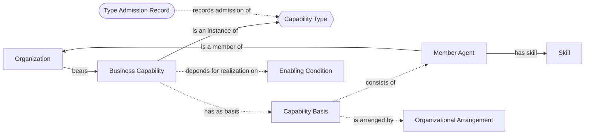
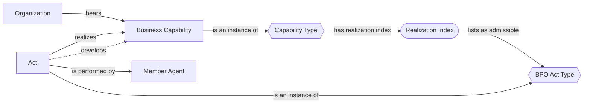
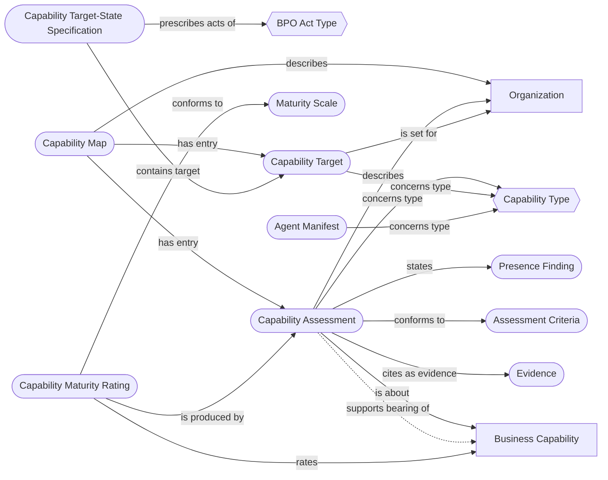
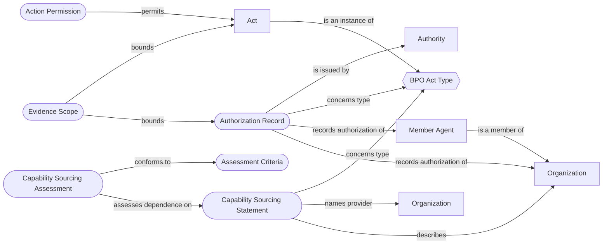
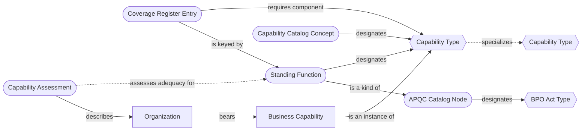

# CM-01 — Business Capability Conceptual Domain Model

| Field | Value |
| --- | --- |
| Model identifier | CM-01 |
| Title | Business Capability Conceptual Domain Model |
| Version | 0.1.0-draft.2 |
| Status | Draft. Not approved. Two decision points (DP-1, DP-2) await the architect |
| Stage | 02 — Conceptual Modeling |
| Standard | `docs/standards/stage-02-conceptual-modeling.md` |
| Stage choices | `docs/decisions/2026-10-25-stage-02-choices.md` |
| Drafted by | Claude Code (claude-opus-5-5), at the architect's direction, 2026-10-25 |
| Approver | The architect |

## 0. Document control

**What this is.** The conceptual domain model the Stage 02 standard asks for: what the
Business Capability Ontology (BCO) is meant to represent, why its principal concepts are
distinguished, how they relate, where the boundaries lie, and which competency questions
the representation must support. It is the design input to ontology formalization
(Stage 05). It contains no OWL, no axioms and no finalized BFO or CCO assignments.

**How it is organized.** The architect chose one domain model organized as patterns
(choice 3 of the stage choices): capability and bearer (P1), realization by BPO acts (P2),
the description layer (P3), sourcing and authorization (P4), and catalog, specialization
and coverage (P5). Each pattern has a Mermaid diagram with its textual description beside
it (choice 2). The Mermaid source in this file is the diagram; the public site renders it.

**What is decided and what is not.** The architect chose to decide RP-1 (the grounding
boundary) and RP-10 (admission versus attribution) through this model (choice 4). They are
§7's decision points DP-1 and DP-2. Under standard §4.6 they are ambiguities that
"materially affect the intended meaning, scope, or principal relationships", so this
model cannot be approved until the architect has decided both and the decisions are
recorded as acts in `docs/decisions/`. Specification v0.5 follows from those decisions.
Nothing here is a decision. In particular, the drafter's recommendations in §7 are inputs.

**Revision history.** 0.1.0-draft.1 (2026-10-25): first draft. 0.1.0-draft.2 (2026-10-25):
answers review R8 (`reviews/R8-cm01-review.md`; proposed disposition
`reviews/R8-disposition.md`). The capability basis may be a single member (R8 finding 2);
a capability may instantiate several types (finding 3); attribution evidence separates
capacity from exercise, so a never-exercised capability can be attributed (finding 4,
proposed to DP-2 as amendment b5); functional adequacy is given a conceptual target and
four aspects (finding 5); BPO integration dependencies are measured and recorded
(finding 6); DP-1 is made decision-ready; §7 gains a decision register. Neither decision
point is presumed decided.

**Inputs.**

| Input | Where | Used for |
| --- | --- | --- |
| Specification v0.4.0-draft.1 (draft) | `specifications/Business-Capability-Ontology-v0.4.0-draft.1.md` | CD1–CD17 as working positions; §4 terms; §7 competency questions; §8 tests G1-T and G1-I; §10 RP-1, RP-10 and open issues |
| Controlled vocabulary (14 concepts, all Draft) | `src/01_controlled_vocabulary/` | Preferred names and draft definitions of the 9 metamodel and 5 catalog concepts |
| Source register and companion | `docs/sources/register.yaml`, `docs/sources/register-companion.md` | Six fault lines and the specification findings SF-01 to SF-10 |
| Review R6 and its accepted disposition | `reviews/R6-vocabulary-review.md`, `reviews/R6-disposition.md` | Findings 1 and 2 (rows R6-02, R6-03, R6-32), deferred to RP-10 and RP-1 |
| Review R7 and its accepted disposition | `reviews/R7-turtle-artifact-review.md`, `reviews/R7-disposition.md` | Findings C and D (rows R7-04, R7-05, R7-17) |
| Review R8 of CM-01 draft.1 and its proposed disposition | `reviews/R8-cm01-review.md`, `reviews/R8-disposition.md` | Findings 1–6, answered in draft.2 |
| BPO at the pinned commit `66131945` | The BPO repository's `ontology/` (slices, wiring, `apqc-ext.ttl`) with the pinned CCO | R8 finding 6: what BPO's capability index entries and shared classes actually are (§9, Q-12 to Q-14) |
| Vendored upstream extracts | `vendor/` | Every BFO, CCO and BPO identifier this model cites is checked against them |

**Reading conventions.** Preferred names of concepts are capitalized (Business Capability).
Relationship names are lower case (bears). Identifiers in code style are either upstream
terms present in the vendored extracts (`cco:`, `obo:`, and BPO's `ex:` act genera) or
controlled vocabulary concepts (`bcom:` metamodel, `bcoc:` catalog). The specification
writes BCO terms with BPO's `ex:` prefix; this model does not repeat that, because those
terms do not exist yet and BCO will not mint them in BPO's namespace. "The specification"
means v0.4.0-draft.1, a draft whose design decisions (CD1–CD17) this model takes as working
positions, not as ratified commitments.

**Representation independence (standard §2.1).** Several of the specification's mechanisms
are representations: a JSON file of capability scopes, a JSON coverage register, a JSON
completeness manifest, and annotation properties. This model names the concepts those
representations carry (Realization Index, Coverage Register Entry, Evidence Scope,
concerns type) and leaves the representations to formalization and integration.

## 1. Scope and purpose

**Purpose.** To fix, before any ontology term is written, a shared understanding of what a
business capability is in this ontology and what it is not; how a capability relates to
the organization that has it, to the people and things it depends on, and to the business
processes the Business Process Ontology (BPO) already models; and how statements about
capabilities (maps, assessments, ratings, targets, sourcing records, authorization records)
relate to the capabilities they are about.

**The domain in one paragraph.** An organization can do things. What it can do is a
business capability: something the organization has, which is there whether or not it is
being exercised, and which shows itself when the organization's members carry out acts of
certain kinds. BPO models those acts. BCO adds what they realize. Around that core sit the
things people write about capabilities — maps, assessments, maturity ratings, targets and
plans — and the records that bear on whether a capability can be used: who provides what
under a sourcing arrangement, and who is authorized to act. A catalog layer connects APQC's
process framework and BCO's own controlled vocabulary to capability types.

**Modeling objectives.**

1. Distinguish having a capability (possession) from being permitted to use it
   (authorization) and from being in a position to use it now (adequacy and availability).
   Review R6 Finding 1 states the requirement: these "are not equivalent".
2. Distinguish a capability type (strategic planning capability) from a particular
   organization's capability of that type, and both from records that refer to a type
   prospectively (a target) or report its absence (an assessment). Review R7 Finding D
   asked for exactly these three patterns.
3. Connect capabilities to BPO act types without minting a new act hierarchy, and without
   claiming that every act of a type needs a capability or that a capability must have
   been exercised.
4. Keep everything said about a capability on the description side, so that a map listing
   a capability never thereby asserts that it exists.
5. Support the fourteen competency questions of specification §7 (traced in §8).

**In scope.** Capabilities borne by organizations; what grounds them and what they depend
on; their realization in BPO acts; their development; the description layer; sourcing and
authorization records; the evidence scope that bounds absence questions; the catalog
bridge from APQC and from the controlled vocabulary; specialization between capability
types; coverage of standing business functions.

**Out of scope.** Individual competency beyond the Skill concept (a person's abilities are
not business capabilities); a new act-type hierarchy (act types come from BPO); a maturity
scoring method (ratings are represented, not prescribed); deontic reasoning (authorization
is recorded, not reasoned over); industry frameworks such as BIZBOK and BIAN (possible later
catalog schemes, subject to their access terms, SF-08); multi-party sourcing (Q-04).

**Intended uses.** Capability-based planning and portfolio analysis over a capability map;
answering whether an organization bears the capabilities a standing function needs;
relating executed business processes to the capabilities they exercise; recording sourcing
dependence and authorization within declared evidence scopes; routing software agents by
the capability types they serve.

## 2. Conceptual diagram

The overview shows the principal concepts of all five patterns and the relationships that
join the patterns. Each pattern's own diagram in §3 adds the remaining concepts.

**Reading the diagram.** Shapes say what kind of thing a concept is: a rectangle is
something that exists in the organization's reality (the organization, its capability,
what grounds the capability, an act); a hexagon is a type (a kind of capability, a kind of
act); a rounded box is information — a record, an index, a catalog entry, a description.
A solid arrow is a relationship the model commits to. A dashed arrow is conditional: it
holds only after a recorded review or decision, or its formal treatment is pending. Here
the two dashed arrows out of Business Capability depend on DP-1 (what grounds a capability
and what it merely depends on), and the dashed arrow from Capability Assessment depends on
DP-2 (what supports a claim that an organization bears a capability). Read left to right,
the centre of the model is: an Organization bears a Business Capability, which is an
instance of a Capability Type; Acts, each an instance of a BPO Act Type, realize it; and
the Capability Type's Realization Index lists which BPO Act Types are admissible
realizations. Everything in the description group points at the reality or the types;
nothing in the reality points back at a description. The catalog group designates types
and lists, per standing function, the capability types it requires.

## 3. Patterns

### P1 — Capability and bearer

**What the pattern settles.** Who has a business capability, what grounds it, what it
merely depends on, and how a capability type comes to count as a kind of disposition.
Specification CD1, CD2, CD3, CD7, CD10. Its dashed relationships are DP-1 and DP-2.

**Reading the diagram.** An Organization bears a Business Capability, and each Business
Capability is an instance of one or more Capability Types (a capability may fall under
several applicable types; recording one primary type is an application convention, not
a principle of the model). Member Agents
(people, and organizations that are members) are members of the Organization; a person's
own ability is a Skill the person has, not a business capability. As the specification
proposes it, and subject to DP-1, the capability has as its basis a Capability Basis that
consists of one or more member agents — a single indispensable member can suffice —
arranged by an Organizational Arrangement — positions,
reporting lines, routines and coordination — which explains why those members, so
organized, give the organization the capability. Systems, equipment, facilities and
external services are Enabling Conditions: the capability depends on them for its
realization, and losing one makes it unavailable rather than making it cease. A Type
Admission Record, written once per Capability Type with no particular organization in
view, records whether capabilities of that type can be genuine dispositions of an
organization (DP-2). Notice what the pattern leaves out: no assignment, responsibility,
charter or authorization appears, because those show that an organization is responsible
or permitted, not that it is able (CD7, G1-I question 2).

### P2 — Realization by BPO acts

**What the pattern settles.** How a capability connects to the business processes BPO
models, and how realizing a capability differs from developing it. Specification CD4,
CD5, CD8, CD12.

**Reading the diagram.** Every Capability Type has a Realization Index that lists, as
admissible, one or more BPO Act Types — the kinds of planned act in which capabilities of
that type may be realized. The index states what is admissible; it does not claim the list
is complete, and it does not claim that every act of a listed type needs a capability (an
external contractor or a single person may perform one). An Act is an instance of a BPO
Act Type, is performed by Member Agents of an organization, and realizes a Business
Capability when it is an exercise of that capability; the act's own type must fall under
one of the types the capability's index lists. An Act may instead develop a capability —
bring it about or improve it — which is a different relationship (CD5); the same act can
do both, and an act can develop one capability while realizing another. The develops arrow
is dashed because no formal relation has been chosen for it (Q-03). A capability need
never have been realized: an unexercised capability is still a capability (CD8).

### P3 — The description layer

**What the pattern settles.** What people write about capabilities, and how each kind of
statement refers to an organization, to a particular capability, or to a capability type.
Specification CD11, CD14, CD17. This pattern carries the three reference patterns of R7
Finding D: designating a type, attributing an instance, and referring to a type that may
have no instance.

**Reading the diagram.** A Capability Map describes one organization and has as its
entries Capability Assessments and Capability Targets; the map's arrangement of entries is
not parthood among capabilities, and listing a capability on a map does not assert that it
exists. Every Capability Assessment describes an organization, concerns exactly one
Capability Type, and states a Presence Finding — present, absent or partial — citing its
Evidence and conforming to stated Assessment Criteria (a partial finding is partial
relative to those criteria, never a fraction of a capability). When the finding is present
and a particular capability is identified, the assessment is about that Business
Capability, and an assessment of that kind is what supports the claim that the
organization bears it (dashed: DP-2). A Capability Maturity Rating rates an existing
Business Capability on a Maturity Scale and is produced by an assessment; there is no
rating of an absent capability. A Capability Target is set for an organization and
concerns a Capability Type the organization is to come to bear, which may have no instance
anywhere; a Capability Target-State Specification is the plan that contains targets and
prescribes acts of the BPO Act Types through which they are to be reached (recruitment,
training, deployment, a sourcing arrangement). An Agent Manifest concerns the capability
types a software agent serves; it describes, and no software agent bears a business
capability. Three ways of referring, then: concerns type (to a kind, with no claim that an
instance exists), is about and rates (to a particular capability that exists), and
supports bearing of (the evidential link for an attribution).

### P4 — Sourcing and authorization

**What the pattern settles.** How an organization's reliance on another organization is
recorded, how authorization is recorded without asserting that permitted acts happened,
and how absence questions are bounded. Specification CD7, CD11, CD15.

**Reading the diagram.** The two Organization boxes are two organizations in different
positions: the consumer on the left, the provider on the right. A Capability Sourcing
Statement describes the consumer, names one provider, and concerns one BPO Act Type — the
kind of act the provider performs for the consumer. The provider's staff perform those
acts, so the consumer bears no capability for them by virtue of the arrangement; the
consumer may also have its own capability for the same acts, and the two coexist. A
Capability Sourcing Assessment assesses the consumer's dependence on one sourcing
statement — risk, substitutability, whether an internal capability exists — against
stated criteria. An Authorization Record records that an Authority authorized an agent
(the organization or one of its members) to perform acts of one BPO Act Type during a
stated period; it does not assert that any permitted act occurred. Only once an act has
occurred does an Action Permission permit that act. An Evidence Scope bounds a collection
of records — authorization records, recorded acts — by organization, agents, act types and
dates: within it, "none recorded" is an answer; outside it, an absence question has the
answer unknown. Authorization appears in this pattern and nowhere in P1: an organization
can be able and not authorized, or authorized and not able.

### P5 — Catalog, specialization and coverage

**What the pattern settles.** How the APQC process framework and BCO's controlled
vocabulary point at capability types, how capability types specialize one another, and
how coverage of a standing business function is recorded. Specification CD9, CD16, and
the catalog bridge of BPO ADR-001 R4 to R6.

**Reading the diagram.** An APQC Catalog Node designates a BPO Act Type when it names a
process; a Standing Function is the kind of catalog node that names an ongoing function
("Manage X") and designates a Capability Type instead (ADR-001 R5 and R6). A Capability
Catalog Concept, an entry in BCO's controlled vocabulary such as `bcoc:StrategicPlanning`,
also designates a Capability Type; the vocabulary concept is a word with a definition, not
the type itself. The two Capability Type boxes are two types: one specializes the other
only when a review has established that every capability of the narrower type is a
capability of the broader type in bearer, grounding and realization (dashed: reviewed,
CD9); a broader type means some ability within its function, not complete ability. A
Coverage Register Entry is keyed by a Standing Function and lists the Capability Types it
requires as components. Whether an organization bears an instance of every component is a
question of component possession; whether those components work together as a whole is a
separate matter for an assessment, never derived from the register. That assessment is a
Capability Assessment that describes the organization and assesses its adequacy for one
Standing Function (dashed: the conceptual target is proposed here, its formal treatment
is open, Q-05). It states separate findings for integration, availability and adequacy
against its own criteria, as §6 sets out, and never takes them from the possession
answer. The register never generates specialization, and neither does APQC's numbering.

## 4. Concept descriptions

Each concept gives the five elements of standard §4.2. "Vocabulary" names the controlled
vocabulary concept where one exists (all are Draft). "Preliminary alignment" is optional
under standard §5 and is not a formal assignment; every identifier in it is present in the
vendored extracts.

### Organization

- **Description.** An organized group of agents — a company, an agency, a department with
  its own standing — that can bear business capabilities and on whose behalf acts are
  performed.
- **Distinguishing characteristics.** Its parts are its member agents. It is the only bearer
  of a Business Capability in this model (CD1, subject to DP-1).
- **Examples.** Acme Ltd; Acme's treasury department, where it is organized as a unit;
  PayCo, Acme's payroll provider.
- **Boundaries.** Not a role, a position or an organization chart. An aggregate of people
  that is not organized as an organization bears member-wise abilities only (CD10).
- **Related concepts.** Member Agent, Business Capability, Capability Sourcing Statement,
  Authorization Record, Capability Map.
- **Preliminary alignment.** `cco:ont00001180` Organization, reused.

### Business Capability

- **Description.** What an organization is able to do: a particular ability of a particular
  organization, present whether or not it is being exercised, and shown when the
  organization's members carry out acts of the kinds its type admits.
- **Distinguishing characteristics.** Borne by an Organization; an instance of one or more
  Capability Types (multiple classification is allowed; a single primary type may be
  recorded by convention); grounded in the organization's own members as organized
  (DP-1); realized only by acts that are exercises of it. It may never have been
  realized, and can still be attributed on evidence of capacity (§6, DP-2 b5).
- **Examples.** Acme's strategic planning capability; Acme's payroll processing capability,
  if Acme's own staff can run payroll.
- **Boundaries.** Not the act (a process), not a role or permission (standing), not a
  person's skill, not a plan or a target, not a description of itself. Possession is
  distinct from availability (an enabling system may be down) and from authorization.
  "Process capability" in ISO/IEC 33020, CMMI and COBIT is a rating of a process, a
  homonym that belongs to the description layer (SF-10).
- **Related concepts.** Organization, Capability Type, Capability Basis, Enabling Condition,
  Act, Capability Assessment, Capability Maturity Rating.
- **Vocabulary.** `bcom:BusinessCapability`.
- **Preliminary alignment.** Under `cco:ont00000568` Organization Capability; whether also
  under `obo:BFO_0000016` disposition is what DP-2 governs.

### Capability Type

- **Description.** A kind of business capability, such as strategic planning capability or
  treasury management capability, identified by its bearer kind, what grounds it, and its
  realization index.
- **Distinguishing characteristics.** Has instances (particular organizations'
  capabilities); has a Realization Index; may specialize another type after review; may be
  admitted as a kind of disposition by a Type Admission Record. Its identity does not come
  from a name or a catalog code.
- **Examples.** Strategic planning capability; treasury management capability; competitive
  analysis capability.
- **Boundaries.** Not a catalog node or a vocabulary concept, which designate it. A type can
  be referred to (by a target, an absent finding) when no organization has an instance.
  Types are not mutually exclusive: one capability may fall under several. BPO already
  declares 145 classes under Organization Capability in its slices (at its pinned commit);
  they are candidates for capability types, not admitted ones, and some were drawn from
  standing-function catalog nodes (Q-12).
- **Related concepts.** Business Capability, Realization Index, Type Admission Record,
  Capability Catalog Concept, Standing Function, Coverage Register Entry.

### Member Agent

- **Description.** An agent that is a member of an organization: a person, or an
  organization that is itself a member.
- **Distinguishing characteristics.** A part of the organization in the sense in which a
  group of agents has agents as parts. Performs acts on the organization's behalf.
- **Examples.** Acme's head of strategy; the analysts in Acme's planning office; a
  subsidiary that is a member of a group.
- **Boundaries.** A contractor's staff are not members of the consumer organization; their
  work is the provider's (CD2). A system is never a member agent.
- **Related concepts.** Organization, Capability Basis, Skill, Act, Authorization Record.
- **Preliminary alignment.** `cco:ont00001017` Agent, as a member part of an Organization.

### Capability Basis

- **Description.** As the specification proposes it: the constituent member agent or agents
  of the organization in virtue of whose being organized as they are the organization has
  a capability.
- **Distinguishing characteristics.** Either a single member agent or a plurality of member
  agents taken together; in both cases a material part of the organization, because the
  organization's members are its parts (SF-03). Losing the basis can end the capability.
  One indispensable member suffices where the capability is realized through
  organizational arrangements (CD2): the basis is then that member, and the capability
  is still the organization's, not the member's Skill.
- **Examples.** The planning office staff and the executive committee members who together
  ground Acme's strategic planning capability; the one analyst who grounds a two-person
  consultancy's competitive analysis capability (R6-08's case).
- **Boundaries.** Not the arrangement itself, which is not material (SF-03), and not a
  "set" or other abstract collection. Not the artifacts, under the specification's
  proposal. What may count as basis is DP-1. Whether a plural basis is formalized as an
  object aggregate or as several basis assertions is a Stage 05 question; either way the
  object of has material basis must be material and part of the bearer.
- **Related concepts.** Business Capability, Member Agent, Organizational Arrangement,
  Enabling Condition.
- **Preliminary alignment.** The object of `obo:BFO_0000218` has material basis, which BFO
  restricts to a material entity that is part of the bearer. Asserting it on a capability
  classifies that capability as a disposition (SF-02), so it is asserted only for admitted
  types.

### Organizational Arrangement

- **Description.** How the members are organized for the capability: positions, reporting
  and decision lines, routines and coordination mechanisms.
- **Distinguishing characteristics.** Explains why the basis grounds the capability; a
  change to it can make or end a capability without any change of membership. Not itself
  material.
- **Examples.** Acme's annual planning cycle; the routing of investment proposals through a
  committee; a standing operating procedure for month-end close.
- **Boundaries.** Not the basis (SF-03), not a role or responsibility assignment (an org
  chart records assignment, not ability), not a plan (a Capability Target-State
  Specification prescribes future acts). Routines are the arranged pattern; their
  enactments are realizations (register fault line 3).
- **Related concepts.** Capability Basis, Member Agent, Business Capability.

### Enabling Condition

- **Description.** Something a capability depends on for its realization that is not its
  basis: a system, equipment, a facility, data, or a service provided from outside.
- **Distinguishing characteristics.** Takes part in realizations. Its absence makes a
  capability unavailable, which an assessment records; under the specification's proposal
  it does not end the capability (CD2). Internal or external depending on ownership or
  control, which sorts dependencies only.
- **Examples.** Acme's core banking platform; a leased warehouse; a market-data feed.
- **Boundaries.** Whether some artifacts are constitutive of a capability rather than
  enabling is DP-1. Not a member agent, and not to be asserted as part of the organization
  (R6 Finding 2's own qualification).
- **Related concepts.** Business Capability, Capability Basis, Capability Assessment,
  Capability Sourcing Statement.

### Skill

- **Description.** A person's own ability to do something.
- **Distinguishing characteristics.** Borne by a person, not an organization. Evidence for an
  organization's capability when the person holds a relevant position (G1-I question 2),
  never the capability itself.
- **Examples.** An analyst's ability to build a discounted cash-flow model.
- **Boundaries.** Out of scope beyond reuse. A person's ability is never a Business
  Capability (CD1); several members each having a skill is member-wise, not organizational
  (CD10).
- **Related concepts.** Member Agent, Evidence, Business Capability.
- **Preliminary alignment.** `cco:ont00000089` Skill, reused.

### Type Admission Record

- **Description.** The recorded result of asking, once per Capability Type and with no
  organization in view, whether capabilities of that type can be genuine dispositions of
  an organization (the specification's G1-T test).
- **Distinguishing characteristics.** About a type, not an instance. A pass licenses
  treating the type as a kind of disposition; it licenses no organization's claim to bear
  one (CD3). Its questions depend on DP-1 (question 2) and its role on DP-2.
- **Examples.** A record that strategic planning capability passes the five questions,
  with reviewer and date.
- **Boundaries.** Not an assessment of any organization, not evidence of possession, not a
  ratification of the type's vocabulary concept.
- **Related concepts.** Capability Type, Capability Assessment.

### Realization Index

- **Description.** The list of BPO act types in which capabilities of a given type may be
  realized.
- **Distinguishing characteristics.** Mandatory for every specific Capability Type. Lists
  what is admissible; claims neither that the list is complete nor that every act of a
  listed type needs a capability. A completeness claim needs its own review (CAP-30).
  Members must be acts that exercise the capability, not develop it (CD5), and must be
  describable without standing or authorization (CD4).
- **Examples.** Strategic planning capability: acts of developing the mission and vision,
  setting strategic objectives, and evaluating strategic options (BPO slice act types).
- **Boundaries.** Not a causal or modal claim. Not coverage (P5). A catalog node is never
  an index member, and neither is a capability type: every member must denote a kind of
  act. BPO's current index entries break this in 14 places (Q-12).
- **Related concepts.** Capability Type, BPO Act Type, Act.

### BPO Act Type

- **Description.** A kind of planned act, taken from the Business Process Ontology's
  reality layer or its shared act genera.
- **Distinguishing characteristics.** BCO uses BPO's act types and never declares its own.
  An act type is admissible for a capability only by being listed in that capability
  type's index.
- **Examples.** `ex:ActOfRemuneration`; `ex:ActOfReporting`; the slice act types for
  strategic planning.
- **Boundaries.** Not a catalog node (the node designates the type). Development acts
  (`ex:ActOfDevelopment`, `ex:ActOfImprovement`, `ex:ActOfOrganizationalEstablishment`,
  `ex:ActOfAcquisition`) need a recorded reason before they enter an index (CAP-06).
- **Related concepts.** Act, Realization Index, Capability Sourcing Statement,
  Authorization Record, Capability Target-State Specification, APQC Catalog Node.
- **Preliminary alignment.** Under `cco:ont00000228` Planned Act, as BPO declares them.

### Act

- **Description.** A particular planned act carried out by members of an organization, such
  as Acme's 2027 mission-setting session.
- **Distinguishing characteristics.** An instance of a BPO Act Type; may realize a business
  capability, develop one, both, or neither.
- **Examples.** Acme's 2027 mission-setting session; PayCo's March payroll run for Acme.
- **Boundaries.** An act performed by a provider's staff realizes the provider's capability,
  not the consumer's. An act's type must be asserted, not inferred, when it is checked
  against an index (CAP-21).
- **Related concepts.** BPO Act Type, Business Capability, Member Agent, Action Permission,
  Evidence Scope.

### Capability Map

- **Description.** A document that describes one organization by listing capability
  assessments and targets as its entries.
- **Distinguishing characteristics.** Its entries are its parts; it carries no type
  reference of its own.
- **Examples.** Acme's 2026 capability map.
- **Boundaries.** Listing a capability does not assert that it exists; the map's layout
  (levels, groupings) is not parthood among capabilities. TOGAF's planning "Capability" and
  FIBF requirement records are description-layer things of other kinds (SF-10).
- **Related concepts.** Organization, Capability Assessment, Capability Target.
- **Vocabulary.** `bcom:CapabilityMap`.
- **Preliminary alignment.** Under `cco:ont00000853` Descriptive Information Content Entity.

### Capability Assessment

- **Description.** A statement describing an organization with respect to the presence,
  absence or partial presence of a capability of one given type, stating that finding and
  citing its evidence and criteria.
- **Distinguishing characteristics.** Concerns exactly one Capability Type; always states a
  Presence Finding; is about a particular Business Capability only when one is identified.
  A present finding citing evidence of capacity is what supports a bearing claim (DP-2);
  evidence that the capability has been exercised supports it too, but is never required,
  so a capability that has never been exercised can be attributed. Availability,
  sourcing and integration are assessed here, never derived. A functional adequacy
  assessment is the same kind of statement directed at a Standing Function rather than a
  Capability Type (§6, RL-39).
- **Examples.** "Acme: strategic planning capability present", citing the planning office
  staffing record and the 2027 mission-setting session; "Acme: treasury management
  capability absent".
- **Boundaries.** Its finding may be wrong; an assessment is evidence, not proof. An
  organization chart, charter, responsibility assignment or authorization record is never
  sufficient evidence of ability (G1-I question 2).
- **Related concepts.** Organization, Capability Type, Business Capability, Presence
  Finding, Evidence, Assessment Criteria, Capability Map, Capability Maturity Rating.
- **Vocabulary.** `bcom:CapabilityAssessment`.
- **Preliminary alignment.** Under `cco:ont00000853` Descriptive Information Content Entity.

### Presence Finding

- **Description.** What an assessment finds: present, absent or partial.
- **Distinguishing characteristics.** Exactly one per assessment. Partial is relative to
  stated criteria (a set of components, a scope, an evaluation criterion).
- **Examples.** Present; absent; partial relative to Acme's treasury component list.
- **Boundaries.** Partial never means a fraction of a capability; capabilities have no
  degrees in reality (maturity is a rating).
- **Related concepts.** Capability Assessment, Assessment Criteria.

### Assessment Criteria

- **Description.** The stated criteria, component set or scope an assessment is relative to.
- **Distinguishing characteristics.** Required for a partial finding and for a sourcing
  assessment; chosen by the assessor, not prescribed by BCO.
- **Examples.** Acme's vendor-dependence criteria; a treasury component checklist.
- **Boundaries.** Not a scoring method mandated by the ontology; not a maturity scale.
- **Related concepts.** Capability Assessment, Capability Sourcing Assessment, Presence
  Finding.

### Evidence

- **Description.** A record an assessment cites in support of its finding.
- **Distinguishing characteristics.** For a bearing claim it must bear on ability. Two
  kinds are distinguished. *Evidence of capacity* shows the organization is able now:
  members with the relevant skills in the positions concerned, the arrangement that
  coordinates them in place, and, where available, a demonstration short of real
  performance (an exercise, a test, a simulation, a qualification). *Evidence of
  exercise* is a recorded realization. Evidence of capacity can suffice alone; evidence
  of exercise supports a claim but is never a prerequisite (CD8).
- **Examples.** Capacity: a staffing record of the planning office and the planning
  procedure it works under; a business-continuity exercise for a capability never yet
  called on. Exercise: the record of the 2027 mission-setting session.
- **Boundaries.** Assignment and permission records (organization chart, charter,
  responsibility assignment, Authorization Record) may be cited but never suffice alone.
  Past exercise is evidence about the past: it supports a present finding only together
  with evidence that the basis and arrangement are still in place.
- **Related concepts.** Capability Assessment, Skill, Act.

### Capability Maturity Rating

- **Description.** An ordinal ranking of an existing capability on a stated scale, produced
  by an assessment.
- **Distinguishing characteristics.** Rates a particular Business Capability that exists;
  carries one ordinal value; cites its scale and the assessment that produced it.
- **Examples.** Acme's strategic planning capability rated 3 on Acme's house scale.
- **Boundaries.** Never a graded capability subtype; never of an absent capability; no
  scale or scoring method is prescribed.
- **Related concepts.** Business Capability, Maturity Scale, Capability Assessment.
- **Vocabulary.** `bcom:CapabilityMaturityRating`.
- **Preliminary alignment.** Under `cco:ont00001010` Ordinal Measurement Information Content
  Entity.

### Maturity Scale

- **Description.** The ordinal scale a rating is given on.
- **Distinguishing characteristics.** Named by every rating; external to BCO.
- **Examples.** A five-level house maturity scale.
- **Boundaries.** BCO represents scales; it does not define or endorse one.
- **Related concepts.** Capability Maturity Rating.

### Capability Target

- **Description.** An objective that an organization come to bear a capability of a given
  type.
- **Distinguishing characteristics.** Refers to a type prospectively; no instance need
  exist. Says what end state, not how to reach it.
- **Examples.** Acme to have a treasury management capability by 2028.
- **Boundaries.** Does not imply the capability is absent now (CQ-8 asks which targets are
  already met), nor that it will be reached.
- **Related concepts.** Organization, Capability Type, Capability Map, Capability
  Target-State Specification.
- **Vocabulary.** `bcom:CapabilityTarget`.
- **Preliminary alignment.** Under `cco:ont00000476` Objective.

### Capability Target-State Specification

- **Description.** A plan that prescribes the acts by which an organization is to reach one
  or more capability targets, which it contains.
- **Distinguishing characteristics.** Contains at least one target; prescribes acts of BPO
  act types such as recruitment, training, deployment or sourcing.
- **Examples.** Acme's treasury build-out plan.
- **Boundaries.** Not adopted or carried out by being written; the end state is the target,
  the route is the plan.
- **Related concepts.** Capability Target, BPO Act Type.
- **Vocabulary.** `bcom:CapabilityTargetStateSpecification`.
- **Preliminary alignment.** Under `cco:ont00000974` Plan.

### Agent Manifest

- **Description.** A record listing the capability types a software agent serves, used to
  route work to it.
- **Distinguishing characteristics.** Concerns types; describes. Software is information,
  so it bears no capability; any function belongs to the computing artifact that runs it,
  which is an Enabling Condition of the organization's capabilities (CD13).
- **Examples.** A manifest saying the strategy assistant serves strategic planning
  capability.
- **Boundaries.** Never a bearer, never a basis.
- **Related concepts.** Capability Type, Enabling Condition.

### Capability Sourcing Statement

- **Description.** A record of an organization's arrangement for obtaining performances of
  one kind of act from one other organization.
- **Distinguishing characteristics.** Two parties: it describes the consumer and names the
  provider. Concerns one BPO Act Type.
- **Examples.** Acme sources payroll runs (`ex:ActOfRemuneration`) from PayCo.
- **Boundaries.** Does not imply the consumer lacks its own capability, nor that the
  consumer bears the provider's. Brokers and provider networks are out of scope (Q-04).
- **Related concepts.** Organization, BPO Act Type, Capability Sourcing Assessment,
  Enabling Condition.
- **Vocabulary.** `bcom:CapabilitySourcingStatement`.
- **Preliminary alignment.** Under `cco:ont00000853` Descriptive Information Content Entity.

### Capability Sourcing Assessment

- **Description.** An assessment of a consumer's dependence on one sourcing arrangement:
  risk, substitutability, and whether the consumer has its own capability for the acts.
- **Distinguishing characteristics.** About one Capability Sourcing Statement; cites
  criteria and evidence.
- **Examples.** Acme's 2026 vendor review of its PayCo dependence.
- **Boundaries.** Dependence is not a defect; the arrangement (statement) and the dependence
  on it (assessment) are distinct (CD17).
- **Related concepts.** Capability Sourcing Statement, Assessment Criteria.
- **Vocabulary.** `bcom:CapabilitySourcingAssessment`.
- **Preliminary alignment.** Under `cco:ont00000853` Descriptive Information Content Entity.

### Authorization Record

- **Description.** A record that an authority authorized an agent to perform acts of one
  type during a stated period.
- **Distinguishing characteristics.** About the acting agent; names one BPO Act Type; has a
  start and end date; cites its authority. Prospective.
- **Examples.** The state regulator authorized Acme to file returns (`ex:ActOfReporting`)
  from 1 January to 31 December 2026.
- **Boundaries.** Not an Action Permission: it does not assert that any permitted act
  occurred, nor that the authorization is valid in fact. Never evidence of ability.
- **Related concepts.** Organization, Member Agent, BPO Act Type, Authority, Evidence
  Scope, Action Permission.
- **Vocabulary.** `bcom:AuthorizationRecord`.
- **Preliminary alignment.** Under `cco:ont00000853` Descriptive Information Content Entity,
  and deliberately not under `cco:ont00000751` Action Permission (CD15).

### Authority

- **Description.** The agent or institution that issues an authorization.
- **Distinguishing characteristics.** Cited by every Authorization Record.
- **Examples.** A state regulator; Acme's board, for internal delegations.
- **Boundaries.** Its own standing is not modeled; deontic reasoning is out of scope.
- **Related concepts.** Authorization Record.

### Action Permission

- **Description.** A permission for an act that actually occurred.
- **Distinguishing characteristics.** Permits a particular act; exists in this model only
  once there is an act to permit.
- **Examples.** The permission under which Acme's 2026 return was filed.
- **Boundaries.** Never used for a prospective authorization, because CCO's definition
  would then assert that a permitted act exists (CD15).
- **Related concepts.** Act, Authorization Record.
- **Preliminary alignment.** `cco:ont00000751` Action Permission, reused, with
  `cco:ont00001910` permits.

### Evidence Scope

- **Description.** The declared scope within which a collection of records is complete: the
  organization, acting agents, act types, start and end dates, and authority sources it
  covers.
- **Distinguishing characteristics.** Turns an empty result into "none recorded within the
  scope"; outside every scope the answer to an absence question is unknown.
- **Examples.** Acme's 2026 authorization register for reporting acts.
- **Boundaries.** Says nothing about the world beyond its scope; "not authorized" is never
  an answer. Its representation (the specification's JSON manifest) is an implementation.
- **Related concepts.** Authorization Record, Act.

### APQC Catalog Node

- **Description.** An entry in the APQC Process Classification Framework as BPO carries it.
- **Distinguishing characteristics.** A catalog entry, kept separate from the reality layer
  (ADR-001); designates the act type or capability type it names.
- **Examples.** A PCF node for processing payroll.
- **Boundaries.** Never an act type, a capability type or an index member itself; its
  numbering generates no specialization. BPO's act types follow PCF 7.4; PCF 8.0 is newer
  (SF-09).
- **Related concepts.** Standing Function, BPO Act Type.

### Standing Function

- **Description.** A catalog node naming an ongoing business function ("Manage X") rather
  than a process, which designates a capability type (ADR-001 R5, R6).
- **Distinguishing characteristics.** Keys the coverage register; need not have a capability
  type of its own. It is what a functional adequacy assessment is directed at (RL-39).
- **Examples.** A "Manage treasury operations" node.
- **Boundaries.** Its coverage is component possession, not integrated ability (CD16).
- **Related concepts.** APQC Catalog Node, Capability Type, Coverage Register Entry,
  Capability Assessment.

### Capability Catalog Concept

- **Description.** An entry in BCO's capability catalog vocabulary: a preferred label and a
  definition designating a capability type.
- **Distinguishing characteristics.** A vocabulary concept with a lifecycle status (all Draft
  today), definitions traced to sources, and a recorded genus.
- **Examples.** `bcoc:StrategicPlanning`, `bcoc:TreasuryManagement`,
  `bcoc:CompetitiveAnalysis`, `bcoc:BusinessModelGovernance`,
  `bcoc:CustomerExperienceManagement`.
- **Boundaries.** A word, not the type; ratifying a concept is not admitting the type
  (Type Admission Record).
- **Related concepts.** Capability Type.

### Coverage Register Entry

- **Description.** For one standing function, the list of capability types it requires.
- **Distinguishing characteristics.** Keyed by the standing function's catalog node, which
  keeps the catalog–reality separation.
- **Examples.** "Manage treasury operations" requires cash management and treasury risk
  capabilities.
- **Boundaries.** Generates no specialization and no assessment; whether components may be
  functions is open (Q-07).
- **Related concepts.** Standing Function, Capability Type.

## 5. Relationship descriptions

Relationships are conceptual (standard §2.4). "Direction" reads From → To. Qualifications
say where a relationship is conditional, and give candidate upstream relations where the
specification proposes one; formal selection belongs to Stage 05.

| ID | Relationship | From | To | Direction | Meaning | Qualifications |
| --- | --- | --- | --- | --- | --- | --- |
| RL-01 | bears | Organization | Business Capability | Directed | The organization has the capability; the capability depends on the organization for its existence | Candidate `cco:ont00001954` has capability, inverse `cco:ont00001889` capability of. A claim needs a supporting assessment (RL-23). Not for member-wise abilities (`cco:ont00001898` aggregate has capability, never for a business capability) |
| RL-02 | is an instance of | Business Capability or Act | Capability Type or BPO Act Type | Directed | The particular falls under the kind | One or more types: multiple classification is allowed, and a single primary type is at most an application convention. A capability is checked against its types' indexes through its realizations (RL-12) |
| RL-03 | is a member of | Member Agent | Organization | Directed | The agent is one of the agents the organization is a group of | A provider's staff are not members of the consumer |
| RL-04 | has as basis | Business Capability | Capability Basis | Directed | The capability exists in virtue of these members, so organized | DP-1. Candidate `obo:BFO_0000218` has material basis, whose use classifies the capability as a disposition (SF-02): asserted only for admitted types |
| RL-05 | consists of | Capability Basis | Member Agent | Directed | The basis is this one member, or these members taken together | DP-1. One member can suffice (R8 finding 2); never an abstract set or the arrangement. Under option B or C the grounding may also include artifacts |
| RL-06 | is arranged by | Capability Basis | Organizational Arrangement | Directed | The arrangement is why these members ground the capability | DP-1. The arrangement is not the basis (SF-03) |
| RL-07 | depends for realization on | Business Capability | Enabling Condition | Directed | Realizations of the capability need this resource; its loss makes the capability unavailable | DP-1 decides whether some resources are constitutive instead. Recorded in assessments, not as parthood |
| RL-08 | has skill | Member Agent | Skill | Directed | The person bears the ability | Candidate CCO bearer relation; evidence for, never identical to, a business capability |
| RL-09 | records admission of | Type Admission Record | Capability Type | Directed | The record states whether capabilities of the type can be dispositions of an organization | DP-2. About a type, never an organization |
| RL-10 | has realization index | Capability Type | Realization Index | Directed | The type's admissible realization types are these | Mandatory for every specific type (CD4) |
| RL-11 | lists as admissible | Realization Index | BPO Act Type | Directed | Acts of this type may realize capabilities of the indexing type | Not exhaustive, not modal; exhaustiveness needs review (CAP-30); development acts need a recorded reason (CAP-06) |
| RL-12 | realizes | Act | Business Capability | Directed | The act is an exercise of the capability | Candidate `obo:BFO_0000055` realizes. The act's asserted type falls under an index member (CAP-21) |
| RL-13 | develops | Act | Business Capability | Directed | The act brings the capability about or improves it | No formal relation chosen (Q-03, OI-4); distinct from RL-12; one act may do both |
| RL-14 | is performed by | Act | Member Agent or Organization | Directed | These agents carry out the act | A provider's staff performing acts for a consumer leaves the consumer with a sourcing arrangement, not a capability |
| RL-15 | specializes | Capability Type | Capability Type | Directed | Every capability of the narrower type is one of the broader type | Reviewed only (CD9, CAP-10); never induced from coverage or APQC numbering. BACM forbids specialization; recorded as a departure (SF-07) |
| RL-16 | describes | Capability Map or Capability Assessment or Capability Sourcing Statement | Organization | Directed | The information is about this organization | Candidate `cco:ont00001982` describes. For a sourcing statement, the organization described is the consumer |
| RL-17 | has entry | Capability Map | Capability Assessment or Capability Target | Directed | The assessment or target is a part of the map | Candidate `obo:BFO_0000178` has continuant part. A map has at least one entry |
| RL-18 | concerns type | Capability Assessment or Capability Target or Agent Manifest or Capability Sourcing Statement or Authorization Record | Capability Type or BPO Act Type | Directed | The information refers to a kind, with no claim that an instance exists | Exactly one per record; capability types for assessments, targets and manifests, act types for sourcing and authorization records (CAP-17). A functional adequacy assessment has none and uses RL-39 instead. Formal treatment is a Stage 05 matter (the specification proposes an annotation) |
| RL-19 | states | Capability Assessment | Presence Finding | Directed | The assessment's finding | Exactly one; partial requires criteria (RL-21) |
| RL-20 | cites as evidence | Capability Assessment | Evidence | Directed | The assessment rests on this record | For a bearing claim, at least one cited record bears on ability (CAP-26). Evidence of capacity can suffice; evidence of exercise is never required (DP-2 b5) |
| RL-21 | conforms to | Capability Assessment or Capability Sourcing Assessment or Capability Maturity Rating | Assessment Criteria or Maturity Scale | Directed | The statement is made relative to these criteria, or on this scale | A rating names exactly one scale |
| RL-22 | is about | Capability Assessment | Business Capability | Directed | The assessment concerns this particular capability | Candidate `cco:ont00001808` is about. Only when a particular capability is identified; an absent finding has none |
| RL-23 | supports bearing of | Capability Assessment | Business Capability | Directed | The assessment is the evidence for the claim that the organization bears this capability | DP-2. A present finding, matching type, citing ability evidence (CAP-26) |
| RL-24 | rates | Capability Maturity Rating | Business Capability | Directed | The rating ranks this existing capability | Candidate `cco:ont00001811` is a ordinal measurement of. The capability must exist |
| RL-25 | is produced by | Capability Maturity Rating | Capability Assessment | Directed | The rating results from this assessment | Every rating cites one |
| RL-26 | is set for | Capability Target | Organization | Directed | The organization is the one that is to come to bear the capability | Candidate `cco:ont00001808` is about |
| RL-27 | contains target | Capability Target-State Specification | Capability Target | Directed | The target is part of the plan | At least one (CAP-31); whether CCO's plan pattern treats objectives as parts is OI-19 |
| RL-28 | prescribes acts of | Capability Target-State Specification | BPO Act Type | Directed | The plan prescribes acts of these kinds | Candidate `cco:ont00001942` prescribes; the plan need not be adopted |
| RL-29 | names provider | Capability Sourcing Statement | Organization | Directed | The organization that performs the acts | Exactly one, distinct from the consumer (CAP-23); multi-party out of scope (Q-04) |
| RL-30 | assesses dependence on | Capability Sourcing Assessment | Capability Sourcing Statement | Directed | The dependence assessed is on this arrangement | One statement per assessment |
| RL-31 | records authorization of | Authorization Record | Organization or Member Agent | Directed | The agent authorized | Exactly one agent; prospective; no act implied |
| RL-32 | is issued by | Authorization Record | Authority | Directed | The authority that issued the authorization | At least one authority source |
| RL-33 | permits | Action Permission | Act | Directed | The permission under which this act occurred | `cco:ont00001910` permits. Only for acts that occurred (CAP-28) |
| RL-34 | bounds | Evidence Scope | Authorization Record or Act | Directed | The record falls within a scope declared complete | Absence answers only within a scope; otherwise unknown (CAP-18) |
| RL-35 | designates | APQC Catalog Node or Standing Function or Capability Catalog Concept | BPO Act Type or Capability Type | Directed | The catalog entry or vocabulary concept names this type | A process node designates an act type; a standing function and a catalog concept designate a capability type |
| RL-36 | is a kind of | Standing Function | APQC Catalog Node | Directed | Standing functions are catalog nodes of a particular kind | ADR-001 R5 decides which nodes |
| RL-37 | requires component | Coverage Register Entry | Capability Type | Directed | The standing function requires a capability of this type | Component possession only; no specialization, assessment or bearing generated (CAP-22, CAP-29) |
| RL-38 | is keyed by | Coverage Register Entry | Standing Function | Directed | The entry is for this function | Keyed by catalog node, not by a capability type |
| RL-39 | assesses adequacy for | Capability Assessment | Standing Function | Directed | The assessment evaluates whether the organization it describes can perform this function adequately as an integrated whole | Proposed in draft.2 (R8 finding 5). Such an assessment concerns no Capability Type; it states findings for integration, availability and adequacy against stated criteria, and none is derived from component possession (CQ-12) or the coverage register (CAP-29). Formal treatment open (Q-05, specification OI-15) |

## 6. Conceptual boundaries

**Distinctions the model depends on.**

| Distinction | Kept apart as | Why it matters | Source of the commitment |
| --- | --- | --- | --- |
| Able / permitted / in a position to | Business Capability; Authorization Record and Action Permission; Enabling Condition and assessment of availability | R6 Finding 1: possession, authorization and circumstances "are not equivalent". Both "able but not authorized" and "authorized but not able" must be representable | CD7, CD15, CD2; register fault line 6 (no source contradicts it) |
| Capability / role / responsibility | Business Capability against Organizational Arrangement and assignment records | An org chart shows responsibility, not ability | CD7, G1-I question 2 |
| Organizational / individual | Business Capability against Skill | A person's ability is not a business capability; several members each able is member-wise | CD1, CD10, SF-05 |
| Organizational / one member | Fragility recorded, not reclassified; the basis may be that one member | A capability resting on one indispensable member is still organizational if realized through organizational arrangements (R6-08's one-analyst firm). Plurality of members is not what makes a capability organizational | CD2; R8 finding 2; DP-1 a1; DP-2 b1 |
| One type / several types | is an instance of, one or more | A capability may fall under several applicable types; a single primary classification is an application convention at most | R8 finding 3 |
| Capacity / exercise | Evidence of capacity against evidence of exercise | A capability never yet exercised is still a capability (CD8) and must be attributable; past exercise alone does not show present capacity | CD8; R8 finding 4; DP-2 b5 |
| Basis / arrangement / enabling condition / realization constraint | Capability Basis; Organizational Arrangement; Enabling Condition; findings in assessments | R6 Finding 2 asks for these four to be distinguished | CD2, SF-03; DP-1 |
| Type / instance / prospective reference | Capability Type; Business Capability; concerns type | R7 Finding D asks for three explicit patterns | CD14; P3 |
| Realization / development | realizes against develops | Building or improving a capability is not exercising it | CD5 |
| Admissible / exhaustive / required | Realization Index; reviewed exhaustiveness; no "requires capability" | An index lists what may realize; it does not claim every act needs a capability | CD4, CD12 |
| Specialization / coverage / decomposition | specializes; requires component; map layout | A broader type is some ability within its function, not the sum of components; maps are not parthood | CD9, CD16, SF-07, fault line 5 |
| Description / described | Description layer against reality | Listing, assessing or targeting a capability asserts nothing about its existence | CD11 |
| Arrangement / dependence | Capability Sourcing Statement against Capability Sourcing Assessment | The contract is not the risk | CD17 |
| End state / route | Capability Target against Capability Target-State Specification | Objectives and plans differ | CD17 |
| Finding / rating | Capability Assessment against Capability Maturity Rating | Ratings rank existing capabilities; assessments find presence | CD17 |
| Recorded absence / absence | Evidence Scope | Open world: an empty result means unknown unless a scope is declared complete | CD15 |
| Vocabulary concept / type / catalog node | Capability Catalog Concept; Capability Type; APQC Catalog Node | Ratifying a word is not admitting a type; a catalog code is not a type | ADR-003; ADR-001 R4 |

**Functional coverage and adequacy (R8 finding 5).** Whether an organization can perform a
standing function is four questions, not one. Each is answered by a different thing in
the model, and none is inferred from another:

| Aspect | Question | Answered by | Never derived from |
| --- | --- | --- | --- |
| Possession of components | Does O bear a capability of every type the function requires? | bears (RL-01) joined to the Coverage Register Entry (RL-37, RL-38); CQ-12 | — |
| Integration and coordination | Do those capabilities work together through O's arrangements, with hand-offs and shared decisions in place? | A finding of a functional adequacy assessment (RL-39), citing the Organizational Arrangement across the components | Possession of components |
| Operational availability | Are the enabling conditions the function needs in place now, internal or sourced? | A finding of the same assessment, citing Enabling Conditions and Capability Sourcing Statements | Possession; integration |
| Adequacy for the function | Is O, so equipped, able to perform the function to the stated criteria (volume, quality, timeliness, risk)? | A finding of the same assessment, against its Assessment Criteria | Any of the three above |

Possession is a conjunction of bearing facts. The other three are judgments an assessor
makes and records, with evidence and criteria; a pipeline that writes them from CQ-12 is
exactly what CAP-29 forbids. No new concept is introduced for this: the assessment is a
Capability Assessment directed at a Standing Function (RL-39) instead of at a Capability
Type, which also gives specification OI-15 a conceptual answer. How its findings are
recorded (one assessment with several findings, or several assessments) and their
value sets are Stage 05 questions.

**Exclusions.** The model represents none of the following as business capabilities:
process capability ratings (ISO/IEC 33020, CMMI, COBIT) and statistical capability
(ISO 3534-2), which are description-layer measurements; FIBF capability records and
TOGAF capability increments, which are requirements and plan units (SF-10); a person's
competence; a software agent's routing profile; an organization chart. It models no
deontic reasoning, no scoring method, no temporal qualification of bearing (Q-06), and no
parthood among capabilities (Q-10).

**Homonym note.** "Capability" in the business-architecture literature usually means what
an organization can do, often bundled with the people, process, information and technology
that deliver it (register fault line 2). This model keeps the ability separate from what it
depends on. Whether every such resource is outside the ability is DP-1.

## 7. Decision points

Two questions materially affect the meaning, scope and principal relationships of this
model (standard §4.6). Each is presented with its options, the review critiques and the
register evidence. Decide DP-1 first: DP-2's type test asks a question (G1-T question 2)
whose wording depends on it.

Each decision is the architect's, recorded verbatim in `docs/decisions/` with the digest of
this file. The record should say which option is chosen and, separately, which of the
listed amendments are accepted. The drafter's recommendation is given last in each, labeled
as such; it is not a decision.

**Decision register.** What needs the architect, and when; what waits for formalization.

| Item | Needs | When | Where in this model |
| --- | --- | --- | --- |
| DP-1 (RP-1): option A, B, C or D | Architect's decision act | Before approval; first | §7 DP-1 |
| DP-1 amendments a1–a4, each accepted or rejected | Architect's decision act, with DP-1 | Before approval | §7 DP-1 |
| DP-2 (RP-10): option A, B or C | Architect's decision act | Before approval; after DP-1 | §7 DP-2 |
| DP-2 amendments b1–b5, each accepted or rejected (b2 needs a yes or no) | Architect's decision act, with DP-2 | Before approval | §7 DP-2 |
| The draft.2 corrections for R8 findings 2–5 (single-member basis, several types, capacity against exercise, functional adequacy) | Architect's review, as part of approving CM-01; the R8 disposition's acceptance | Before approval | §4, §5 (RL-02, RL-05, RL-18, RL-20, RL-39), §6 |
| CM-01 approval | Architect's approval act, cited in §10 | After all rows above | §10 |
| Specification v0.5 (CD1–CD3, §8 G1-T and G1-I, OI-15) | Drafted from the decisions; ratified separately | After approval | — |
| Formal placement under disposition; reuse of CCO's Organization Capability pattern | Deferred to Stage 05 | Formalization | Q-09 |
| Form of a plural basis (object aggregate or several assertions) | Deferred to Stage 05 | Formalization | Capability Basis |
| Relation for develops | Deferred to Stage 05 | Formalization | Q-03 |
| Treatment of concerns type and of RL-39 (annotation or otherwise); finding value sets, including adequacy findings | Deferred to Stage 05 | Formalization | RL-18, RL-39, §6 |
| CCO identifiers still to verify (specification OI-8) | Deferred to Stage 05 | Formalization | — |
| BPO integration: index entries that name capability classes; inconsistent shared declarations; slice act types not vendored | Deferred to integration, validated before Stage 05; raising them with BPO is the architect's call | Before formalization | Q-12, Q-13, Q-14 |
| PCF edition (7.4 or 8.0) | Architect's call to raise with BPO | Any time | Q-11 |
| Organization-only bearer departures by source and clause | Specification v0.5 | After approval | Q-08 |
| Multi-party sourcing; components that are functions; parthood among capabilities; temporal bearing | Carried open | Later | Q-04, Q-07, Q-10, Q-06 |

### DP-1 — RP-1: the grounding boundary

**Decision:** pending

**The question.** What bears a business capability, what grounds it, and where does the
line fall between what grounds it and what it merely depends on? Specifically: is the
capability's basis the organization's member agents only, with systems, equipment,
facilities and outside services as enabling conditions — or can artifacts be part of what
grounds it?

**Why it is material.** It decides the meaning of four relationships (RL-04 to RL-07), the
answer to "does the capability survive losing its platform?", what G1-T question 2 and
G1-I question 1 ask, what CAP-25 checks, and whether CCO's Organization Capability (a
capability of an Organization, which CCO defines as a group of agents) can be reused as is.

**Critiques.**

- *R6 Finding 2* (critical): the member-only basis "is too categorical". BFO's has material
  basis requires a material part of the bearer in virtue of which the disposition exists;
  whether a capability survives losing a specialized machine or a configured system
  "cannot be stipulated uniformly for every capability". R6 recommends distinguishing
  material constitution, organizational configuration, necessary enabling conditions and
  temporary realization constraints, and asserting has material basis only where BFO's
  definition holds. R6 also qualifies its own finding: equipment should not be asserted as
  part of the organization, and BCO "is right to distinguish organizational members from
  external resources". Disposition rows R6-03 and R6-32 deferred this to RP-1.
- *R6 Finding 1*: test the modeling choice against cases where membership stays constant
  but authority, procedures, resources or coordination change (the table below does this).
- *R7 Finding C*: has material basis is not resource dependency; a software system,
  production facility or external service "cannot simply be treated as an organizational
  member". Reuse CCO's Organization Capability pattern. Disposition row R7-05 deferred this
  to RP-1; R7-04 deferred the CCO pattern to the formal layer.
- *R8 finding 1* (critical): recommends option A with a1–a4, "subject to the architect's
  explicit decision", and asks that A's consequence — permanently removing an essential
  platform does not by itself end the capability — be documented as a commitment rather
  than assumed to be universally true. R8 finding 2 asks that the basis admit a single
  member; a1 now says so.

**Register evidence.**

- *SF-03*: the object of has material basis must be a material part of the bearer. Member
  agents qualify (an Organization is a group of agents). "Their arrangement" is not a
  material entity, and a "set" is not either. The specification's CD2 uses both words.
- *SF-02*: has material basis has disposition as its domain, so asserting a basis on a
  capability classifies it as a disposition, whether or not its type has been admitted.
- *SF-06, fault line 2*: counting technology on the capability side is the defence and
  enterprise-architecture mainstream (NAF and UAF Capability Configurations, APQC, G211,
  DM2). NAF and UAF's Capability Configuration is the closest authoritative analogue of a
  material basis, and it includes technology. The opposite camp (Homann, Offerman et al.,
  Ulrich and Rosen, ITIL) supports the specification's bank-platform example. No
  practitioner source states that member agents in their arrangement are the basis; it must
  be argued from Helfat and Peteraf, Calhau et al., Beverley et al., and BFO's definition.
- *SF-05, fault line 1*: no source restricts capability bearers to organizations; many keep a
  person's ability as a separate concept, which supports sending it to Skill.
- *Specification OI-14*: a socio-technical system bearer, whose parts include members and
  artifacts, would let capability loss track platform loss.

#### Options

**Option A — member-agent basis; artifacts are enabling conditions (the specification's
v0.4 proposal).** The Organization alone bears the capability. Its basis is an aggregate of
member agents; the Organizational Arrangement explains why they ground it; systems,
equipment, facilities and outside services are Enabling Conditions, whose loss makes the
capability unavailable, recorded in an assessment. The model as drawn in P1. *Gains:* reuses
CCO's Organization Capability and Organization unchanged; satisfies BFO's material-basis
condition for every basis asserted (members are parts of the organization); one bearer to
query (CQ-1). *Costs:* a bank whose core platform is decommissioned, staff unchanged, keeps
its capability latently and is assessed unavailable — R6's objection; departs from NAF, UAF,
APQC and DM2 (SF-06).

**Option B — a socio-technical bearer for every capability.** The bearer of a business
capability is a socio-technical system: a material whole whose parts include member agents
and artifacts, related to the Organization that operates it. Losing a constitutive artifact
can end the capability. *Gains:* capability loss tracks platform loss; closest to NAF and
UAF's Capability Configuration. *Costs:* the bearer is no longer the Organization, so CCO's
Organization Capability cannot be reused directly and CD1 is replaced; a new bearer concept
must be defined and grounded; every capability, including the purely human ones, takes on
the extra structure; CQ-1 must go through the system.

**Option C — member-agent basis by default; socio-technical grounding per type when
reviewed.** As A, except that a Capability Type may be admitted with socio-technical
grounding when its type review shows an artifact is constitutive — that permanently losing
it ends the ability rather than suspending it. *Gains:* takes R6's "cannot be stipulated
uniformly" literally; keeps A's simplicity for most types. *Costs:* two bearer patterns; the
socio-technical bearer still has to be defined (OI-14); CQ-1 must look in two places; the
line between constitutive and enabling is itself a review judgment that will be contested.

**Option D — no basis in the model yet.** The Organization bears; grounding is recorded
only as what an assessment cites (candidate basis members or positions), and has-as-basis is
dropped from the model until formalization. *Gains:* asserts has material basis nowhere, so
never asserts it where BFO's definition may fail; sidesteps SF-02. *Costs:* the model no
longer says why a capability exists or persists; CAP-25 has nothing to check; the decision
is postponed to Stage 05, where standard §8.2 expects the conceptual meaning to be settled.

**Membership constant, something else changes (R6 Finding 1).**

| Case | Option A | Option B | Option C | Option D |
| --- | --- | --- | --- | --- |
| Authority withdrawn (licence lapses) | Capability unchanged; Authorization Record expires | Unchanged | Unchanged | Unchanged |
| Procedures or coordination dismantled (planning committee disbanded) | Arrangement changes; the capability can end, since the arrangement is why the basis grounds it | Can end | Can end | Assessment records it; model silent on why |
| Enabling system lost temporarily (outage) | Unavailable; assessed | Unavailable | Unavailable | Assessed |
| Enabling system decommissioned permanently | Persists latently; assessed unavailable | Ends if the system was constitutive | Ends for types reviewed as socio-technical; otherwise as A | Assessed; model silent |
| Outside provider takes over the acts | Consumer's capability persists only if its own members can still perform them; a sourcing statement records the arrangement | As A | As A | As A |

**Effect on the bearer and grounding relationships.**

| Relationship | Option A | Option B | Option C | Option D |
| --- | --- | --- | --- | --- |
| bears (RL-01) | Organization only | A Socio-Technical System, which the Organization operates; two new conceptual relationships | Organization; for reviewed types, a Socio-Technical System the Organization operates | Organization only |
| has as basis (RL-04) | Solid; asserted for admitted types (a2) | Replaced: the system's parts ground it | Solid by default; system parts for reviewed types | Removed from the model |
| consists of (RL-05) | One or more member agents | Members and artifacts, as system parts | As A, or as B for reviewed types | Removed |
| is arranged by (RL-06) | Solid | Solid, over the system | Solid | Kept as description only |
| depends for realization on (RL-07) | Solid; every artifact | Only non-constitutive artifacts | As A, except constitutive artifacts of reviewed types | Solid |
| Enabling Condition concept | Unchanged | Split: constitutive and enabling | Split for reviewed types | Unchanged |
| G1-T question 2 | As stated; a type that fails goes to OI-14 (a4) | Replaced by a system-composition question | Gains a branch: constitutive artifact or not | Dropped |
| CQ-1 | One path | Through the system | Two paths | One path |
| CCO Organization Capability reuse | Direct, for every type | Lost | Lost for reviewed types | Direct |

**Amendments, available with A or C.** a1 — reword CD2 so the basis is the relevant
constituent member agent or agents — one member can suffice — and the arrangement is the
reason they ground the capability, not part of the basis; neither the arrangement nor an
abstract set is ever the basis (SF-03; R8 findings 1 and 2). a2 — assert a basis only for
a capability whose type has passed type admission (SF-02). a3 — adopt R6's four-way
distinction explicitly: material constitution (the basis), organizational configuration
(the arrangement), enabling conditions, and temporary realization constraints (recorded
as findings). a4 — keep OI-14 open for cases where evidence shows socio-technical
grounding is needed, cite NAF and UAF for it (SF-06), make G1-T question 2 the place a
type is sent there, and record the rationale and consequences of the chosen boundary.

**Drafter's recommendation (not a decision).** Option A with amendments a1 to a4. A keeps
CCO's Organization Capability, which R7 asks BCO to reuse, and satisfies BFO's definition of
material basis for every basis it asserts, which is R6's and R7's formal point. a3 answers
R6's request for four distinctions inside the model, and a4 keeps C available for the first
type whose review shows an artifact is constitutive, without building a second bearer
pattern before a case needs one. The cost to record is the departure from NAF, UAF, APQC and
DM2 (SF-06) and the bank-platform consequence, which the specification already states. R8
reaches the same recommendation independently. No capability type has yet passed type
admission, and the five catalog types all appear member-grounded, so no current case
calls for C.

**The commitment A makes, stated so it can be accepted or rejected.** Under A, permanently
removing an artifact a capability depends on — even an essential platform — does not by
itself end the capability. The capability persists, latent, and an assessment records it
as unavailable until the artifact is replaced. The capability ends only when its basis or
its arrangement goes. This is a modeling commitment of this ontology, not a claim that
every business-architecture source agrees (SF-06 lists those that do not), and under a4
it is revisited for any type whose review shows an artifact is constitutive.

**If option A is chosen, what changes in CM-01.** The four dashed arrows in P1 and the
overview become solid; Capability Basis, Organizational Arrangement and Enabling Condition
lose their "as the specification proposes it" hedges; a1–a4 as accepted are written into
§4 and §6; Q-01 is closed citing the decision; A-02 becomes the stated ground for the
basis; the commitment above moves into §6 as a boundary. Nothing in P2–P5 changes.

**What the DP-1 decision record must capture.** The option chosen; each of a1–a4 accepted
or rejected; the rationale; the limitations acknowledged (for A, the commitment above and
the SF-06 departures); the implications for CM-01 (the list above, or its equivalent for
another option); and the SHA-256 of this file at the commit decided on, so the decision is
about a fixed text.

### DP-2 — RP-10: admission and attribution

**Decision:** pending

**The question.** How does BCO decide that capabilities of a type can be genuine
dispositions of an organization (admission), and separately that a particular organization
bears one (attribution)? Are these two tests, one, or a single test at the instance level?

**Why it is material.** It decides what a Type Admission Record is (RL-09) and whether it
exists at all; what supports a bearing claim (RL-23); whether a type can sit in a staging
state under Organization Capability without being a disposition (specification OI-7); and
how CQ-10 and CQ-13 are answered.

**Critiques.**

- *R6 Finding 1*: retain disposition as the working parent, but "make the criteria for an
  organization-borne disposition explicit", tested against changes in authority,
  procedures, resources and coordination; the classification should be established through
  cases "rather than assumed from business architecture usage". Disposition row R6-02
  deferred this to RP-10 and named G1-T's five questions as the criteria.
- *R6 on competitive analysis* (row R6-08): the decisive criterion is "the bearer and its
  capacity, not the number of individuals executing the work" — a one-analyst consulting
  firm can bear the capability. The clause was removed from the catalog definition; G1-T
  question 3 asks almost the same thing of every type, and the disposition notes it for
  RP-10.
- *R7 Finding C*: the class is plausible and no inconsistency was found, but formal
  conformance is untested. (The architect has directed that formalizing classes is not the
  next step; this model records the conceptual question only.) Disposition row R7-17
  deferred this to RP-1 and RP-10.
- *R7 Finding D*: separate capability-type designation, instance attribution and prospective
  reference. Admission is about a type; attribution about an instance.
- *R8 finding 4* (high): the specification admits capabilities never realized (CD8), but
  G1-I's emphasis on actual performance risks excluding them. Separate evidence of capacity
  from evidence of past exercise; performance "may support attribution, but it must not be
  a universal prerequisite". Resolve DP-1 first. Amendment b5 below answers it.

**Register evidence.**

- *SF-01*: placing capability under disposition has BFO-family precedents (IOF Core;
  Beverley et al. 2024), and CCO declines it without stating why (Agent Capability and
  Organization Capability sit under realizable entity). Neither precedent is an ISO normative
  text; one is a preprint.
- *SF-04*: IOF and Beverley et al. both require an agent with an interest in the
  realization; BCO says nothing about it. An organization's own interest plausibly
  satisfies it.
- *SF-02*: recording a basis on a capability is itself admission, so a staged type can carry
  no basis assertion.
- *Fault line 6*: no source contradicts the separation of ability from assignment, which
  G1-I question 2 relies on.

#### Options

**Option A — two tests (the specification's v0.4 proposal).** A Type Admission Record (G1-T,
five questions: bearer kind, basis kind, organizational not individual, non-deontic,
exercise not development) is written once per type; a pass admits the type as a kind of
disposition. Each claim that an organization bears a capability needs a supporting
Capability Assessment answering G1-I's five questions (candidate basis, ability evidence,
own performance, enabling conditions, fragility). A type not yet admitted is staged under
Organization Capability alone, transitionally, and counted by CQ-10. *Gains:* type questions
are asked once, not per organization; attribution never rides on admission; matches R7
Finding D's split; R6's criteria become explicit and recorded. *Costs:* a staging state
outside BFO's role/disposition split (OI-7), which must stay transitional; two kinds of
record to maintain.

**Option B — admission by definition; attribution per claim.** Every business capability is
a disposition by definition (SF-01's precedents); a type is admitted when it is written,
and only attribution is tested, by G1-I. *Gains:* no staging state; one fewer record kind;
aligned with IOF and Beverley et al. *Costs:* the classification is assumed rather than
established case by case, which is what R6 Finding 1 warns against; nothing catches a type
that is really a skill, a role or a socio-technical ability before organizations are
attributed it; CQ-10 becomes vacuous.

**Option C — attribution only.** No type-level test; each bearing claim carries the whole
analysis, type questions included. *Gains:* one record per claim. *Costs:* the same type
questions are re-answered per organization and can be answered inconsistently; type and
instance are conflated, against R7 Finding D; CQ-10 cannot be answered.

**Amendments, available with A (b1 and b2 also with B; b5 with any option).** b1 — reword G1-T question 3 so it
asks whether realizations run through the organization's arrangements, which may involve
one member, rather than through coordination across several positions (R6-08). b2 — add
SF-04's interest condition as a sixth G1-T question, or record why BCO declines it. b3 — use
R6 Finding 1's constant-membership cases (DP-1's table) as worked examples in every type
review. b4 — bound the staging state: a type that fails G1-T is reclassified or removed, never
left staged (the specification's CD3 already says so; make it a review rule). b5 — separate
capacity from exercise in G1-I (R8 finding 4): question 2 asks for evidence of capacity
(members with the skills in the positions concerned, the arrangement in place, a
demonstration short of real performance where one exists), with a recorded realization as
supporting evidence that is never required; question 3 asks *who would* perform realizing
acts — the organization's own members, or a provider — rather than whether any act has been
performed; and a present finding resting only on past exercise must also show the basis
and arrangement are still in place. b5 applies under every option, since all three keep
G1-I.

**Drafter's recommendation (not a decision).** Option A with b1, b3, b4 and b5, and a
decision on b2 either way. A is the only option that keeps admission a matter of types and
attribution a matter of evidence about one organization, which is R7 Finding D's split and
R6 Finding 1's request for explicit criteria. b1 removes the one-analyst objection without
weakening the organizational test. b5 makes G1-I consistent with CD8: without it, a
capability the specification says may never have been realized could never be shown
present. b2 is cheap to adopt and aligns with both BFO-family precedents, but it adds a
commitment no reviewer asked for, so it is listed for the architect rather than
recommended.

## 8. Requirements traceability

Every competency question in specification §7 is traced to the patterns, concepts and
relationships that answer it. Questions marked ‡ ask about absence and are answered only
within an Evidence Scope.

| CQ | Question | Patterns | Concepts | Relationships | Notes |
| --- | --- | --- | --- | --- | --- |
| CQ-1 | Which capabilities does organization O bear? | P1 | Organization, Business Capability, Capability Type | RL-01, RL-02 | Only supported claims count (CQ-13) |
| CQ-2 | Which BPO act types are admissible realizations of capability type C? | P2 | Capability Type, Realization Index, BPO Act Type | RL-10, RL-11 | Admissible, not exhaustive |
| CQ-3 | Which capabilities did this act instance realize? | P2 | Act, Business Capability, BPO Act Type, Realization Index | RL-12, RL-02, RL-11 | Act's asserted type must fall under an index member |
| CQ-4 ‡ | Which capabilities that O bears at query time have no recorded realization in period P? | P1, P2, P4 | Organization, Business Capability, Act, Evidence Scope | RL-01, RL-12, RL-34 | No temporal qualification of bearing (Q-06) |
| CQ-5 ‡ | Which index act types of O's capabilities lack an applicable Authorization Record for acting agent A and period P? | P2, P4 | Organization, Business Capability, Realization Index, BPO Act Type, Authorization Record, Member Agent, Evidence Scope | RL-01, RL-10, RL-11, RL-18, RL-31, RL-34 | "None recorded within the scope", never "not authorized" |
| CQ-6 | Which capability types does O's map record as needed (a target entry) with no assessment entry finding them present? | P3 | Capability Map, Capability Target, Capability Assessment, Presence Finding, Capability Type | RL-17, RL-18, RL-19 | Entries joined on the type they concern |
| CQ-7 | For which act types does O have a sourcing arrangement, with which provider, and for which does O also bear a capability indexing that act type? | P4, P1, P2 | Capability Sourcing Statement, Organization, BPO Act Type, Business Capability, Capability Type, Realization Index | RL-16, RL-29, RL-18, RL-01, RL-02, RL-10, RL-11 | Two-party arrangements only (Q-04) |
| CQ-8 | Which capability targets does O have, and which already match a capability O bears? | P3, P1 | Capability Target, Capability Type, Organization, Business Capability | RL-26, RL-18, RL-01, RL-02 | A target does not imply absence |
| CQ-9 | Which APQC catalog nodes are standing functions with a capability class? | P5 | APQC Catalog Node, Standing Function, Capability Type | RL-36, RL-35 | — |
| CQ-10 | Which capability classes have not passed G1-T? | P1 | Capability Type, Type Admission Record | RL-09 | Depends on DP-2; vacuous under its option B |
| CQ-11 | Which acts develop capability C, as distinct from realizing it? | P2 | Act, Business Capability | RL-13, RL-12 | No formal relation yet (Q-03) |
| CQ-12 | Does O bear an instance of every capability class listed as a required component of standing function F? | P5, P1 | Coverage Register Entry, Standing Function, Capability Type, Organization, Business Capability | RL-38, RL-37, RL-01, RL-02 | Component possession only. Integration, availability and adequacy are findings of an assessment directed at F (RL-39, §6), never derived from this answer |
| CQ-13 | Which of O's capability-bearing claims lack a supporting present-finding assessment? | P1, P3 | Organization, Business Capability, Capability Assessment, Presence Finding, Evidence | RL-01, RL-23, RL-19, RL-20 | Depends on DP-2. Under b5 a supporting assessment may cite evidence of capacity alone, so a never-exercised capability is not reported for lacking a realization |
| CQ-14 | Which of O's sourcing arrangements have no sourcing assessment of the dependence? | P4 | Capability Sourcing Statement, Capability Sourcing Assessment, Organization | RL-16, RL-30 | — |

**Use cases served.** Capability-based planning (CQ-6, CQ-8, CQ-12); evidence and audit of
capability claims (CQ-1, CQ-13, CQ-10); process-to-capability analysis (CQ-2, CQ-3, CQ-4,
CQ-11); sourcing and compliance (CQ-5, CQ-7, CQ-14); catalog alignment (CQ-9).

## 9. Assumptions and open questions

### Assumptions

- **A-01.** BPO supplies every act type; BCO declares none and adds what those acts realize.
- **A-02.** An organization is a group of agents whose parts are its members, as CCO defines
  it. DP-1's option A rests on this.
- **A-03.** A capability type is identified by its bearer kind, its grounding and its
  realization index together; no name or catalog code identifies it (CD4).
- **A-04.** Nothing in the description layer bears or realizes a capability (CD11).
- **A-05.** Reasoning is open-world; absence questions are answered only within a declared
  evidence scope (CD15).
- **A-06.** The specification's design decisions are working positions. Where this model
  departs from v0.4 it says so, and the departure is an input to v0.5, not a change to the
  specification.
- **A-07.** Vocabulary concepts designate types and are not the types; their lifecycle
  (ADR-003) is separate from type admission.

### Open questions

- **Q-01.** DP-1 (RP-1): what grounds a capability, and what it only depends on.
  *Blocks approval.*
- **Q-02.** DP-2 (RP-10): how types are admitted and claims attributed. *Blocks approval.*
- **Q-03.** Which relationship links a development act to the capability it develops
  (specification OI-4)? CQ-11 is answered by review records until one is chosen.
  *Carried forward.*
- **Q-04.** Multi-party sourcing — brokers, intermediaries, provider networks — is outside
  the two-party statement (OI-18). *Carried forward.*
- **Q-05.** An integrated-adequacy assessment of a function with no capability type of its
  own has no type to concern (OI-15). Draft.2 gives it a conceptual target: it assesses
  adequacy for the Standing Function (RL-39), with the four aspects of §6. Still open: how
  that is formalized, and the findings' value sets. *Carried forward.*
- **Q-06.** Bearing has no temporal qualification; CQ-4 asks about capabilities borne at
  query time. *Carried forward.*
- **Q-07.** May a coverage register component itself be a standing function (OI-13)?
  *Carried forward.*
- **Q-08.** The organization-only bearer departs from every source family (SF-05); the
  departures should be listed by source and clause in specification v0.5. *Carried forward.*
- **Q-09.** Formal placement — whether business capability is asserted under disposition,
  and how CCO's Organization Capability pattern is reused (R7 Finding C) — belongs to
  Stage 05. *Carried forward.*
- **Q-10.** Parthood among capabilities is not modeled; maps' hierarchies are read as
  detailing or partitioning (Calhau et al.), not as parthood (fault line 5).
  *Carried forward.*
- **Q-11.** Should the catalog take PCF 8.0 rather than BPO's PCF 7.4 (SF-09)? Raising it
  with BPO is the architect's call. *Carried forward.*
- **Q-12.** BPO's realization index entries do not all name acts (R8 finding 6). At BPO's
  pinned commit `66131945`, with the pinned CCO and BFO loaded, 347 of the 361
  `enablesProcess` entries (356 in `capabilities_wiring.ttl`, 5 in
  `capabilities_roles.ttl`) name classes that reach CCO Planned Act; 14, all to slice 12.0
  catalog-derived classes, name classes that are themselves under Organization
  Capability — for example, legal and compliance capability indexing "Ensure compliance"
  and stakeholder relationship management capability indexing "Manage government
  relations". Those are standing functions modeled as capabilities, so as index members
  they would point a capability at a capability, which the Realization Index forbids. They
  must be re-indexed to the acts those functions contain before any BCO capability type
  takes its index from BPO. BPO's slices also declare 145 classes under Organization
  Capability; the specification plans to move them into BCO, as candidates for type
  admission. *Carried forward.* Integration; validated before Stage 05.
- **Q-13.** BPO's shared classes are declared repeatedly with differences (R8 finding 6).
  At the same commit, 115 classes are declared in two or more BPO modules; 52 of them carry
  differing definitions across modules (among them the act genera Act of Reporting and Act
  of Forecasting), and 4 carry differing named superclasses (Business Strategy, Production
  Equipment, Raw Material, Returned Product). None of the six act genera this model cites
  is affected in its superclass: all six reach Planned Act and none falls under
  Organization Capability. Which definition is authoritative for a genus is BPO's to
  settle, under its single-source rule for shared terms. *Carried forward.* Integration;
  validated before Stage 05.
- **Q-14.** The vendored BPO extract holds only `apqc-ext.ttl`'s act genera, so this model
  cites no slice act type by identifier, and Stage 05 cannot check an index against BPO
  until the extract includes the slices it needs. *Carried forward.* Integration.

## 10. Review status

| Item | State |
| --- | --- |
| Approved | no |
| DP-1 (RP-1) | pending |
| DP-2 (RP-10) | pending |
| Stakeholder review | R8 reviewed draft.1; draft.2 answers it (disposition proposed) |
| Automated completeness check | `tools/conceptual/check_models.py` |

**Quality gates (standard §7), as the drafter assesses them for review.**

- [x] The purpose and scope are clearly defined (§1).
- [x] Principal domain concepts have been identified and described (§4, 32 concepts).
- [x] Important conceptual distinctions are documented (§6).
- [x] Meaningful relationships are represented and explained (§5, 39 relationships).
- [x] The model addresses the intended requirements and competency questions (§8).
- [x] Diagrams and textual descriptions are consistent (checked by the completeness checker
  for names; by review for meaning).
- [x] Significant ambiguities and assumptions have been documented (§7, §9).
- [ ] No unresolved conceptual question materially prevents agreement — DP-1 and DP-2 are
  open.
- [ ] Domain stakeholders have reviewed the model — R8 reviewed draft.1; review of draft.2
  and acceptance of the R8 disposition are pending.
- [ ] The model provides sufficient conceptual clarity to guide ontology formalization —
  only after DP-1 and DP-2.

**To approve.** The architect decides DP-1 and DP-2, each recorded verbatim in
`docs/decisions/` with this file's digest; the model is revised to the decisions (the
dashed relationships become solid, or change, as decided); stakeholder review is recorded;
and the Approved row cites the approval act. Specification v0.5 then carries the decisions
into CD1–CD3 and §8.

## Sources

Every source is in this repository. External works are cited through the source register,
`docs/sources/register.yaml`, whose companion `docs/sources/register-companion.md` holds the
fault lines and the findings SF-01 to SF-10 cited above.

- Stage 02 standard: `docs/standards/stage-02-conceptual-modeling.md`
- Stage choices: `docs/decisions/2026-10-25-stage-02-choices.md`
- Specification v0.4.0-draft.1: `specifications/Business-Capability-Ontology-v0.4.0-draft.1.md`
  (§3 CD1–CD17, §4 terms, §7 competency questions, §8 G1-T and G1-I, §10 RP-1, RP-10, open
  issues OI-4, OI-7, OI-13, OI-14, OI-15, OI-18, OI-19)
- Review R6: `reviews/R6-vocabulary-review.md` §2 Findings 1 and 2, §3.2; disposition
  `reviews/R6-disposition.md` rows R6-02, R6-03, R6-08, R6-32
- Review R7: `reviews/R7-turtle-artifact-review.md` §3 Findings C and D; disposition
  `reviews/R7-disposition.md` rows R7-04, R7-05, R7-17
- Review R8 (of this model's draft.1): `reviews/R8-cm01-review.md`; proposed disposition
  `reviews/R8-disposition.md`
- BPO at commit `66131945b525c54f44e4962f32bb1f52dfa0cd12` (the vendored extract's pin),
  read with the pinned CCO and BFO, for Q-12 to Q-14
- Controlled vocabulary: `src/01_controlled_vocabulary/metamodel.yaml`,
  `src/01_controlled_vocabulary/catalog.yaml`
- Vendored extracts: `vendor/bfo/`, `vendor/cco/`, `vendor/bpo/`
